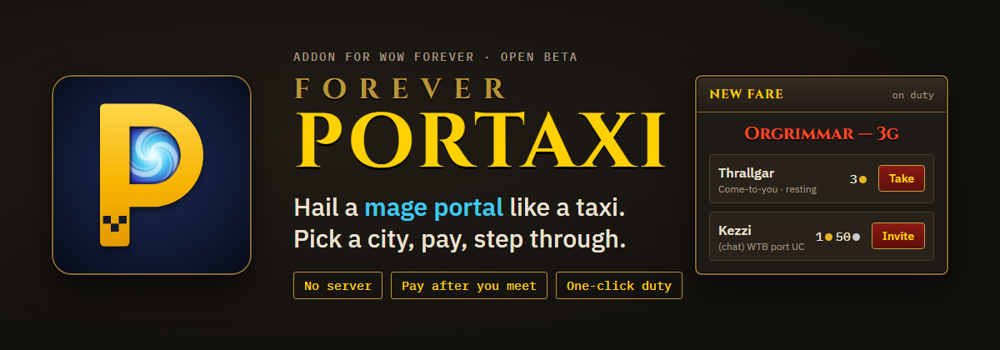
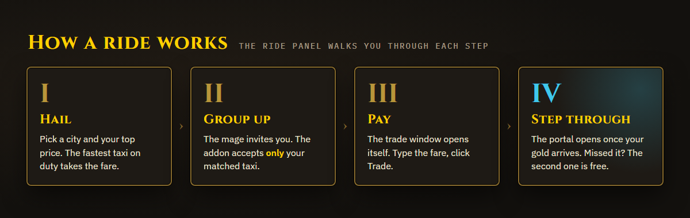

## Stop spamming "WTB port Org"

**ForeverPortaxi turns every mage running the addon into a taxi on call.** Pick a city, set the most you'll pay, and
the fastest mage on duty takes the fare. ForeverPortaxi does the matching, the party invite and the trade window. You
just pay and step through the portal.

No server, no website, no account. The addons talk to each other over a hidden chat channel, so it works as
soon as two players have it installed.

## For riders (any class)

- **Every city at a glance.** One tile per city of your faction, with the cheapest fare and how many taxis
  serve it right now.
- **Hail.** Set your top price and click *Hail a taxi*. The fastest mage takes it, and you pay **that mage's
  own price**, not your maximum.
- **Or browse.** See every taxi for the city, cheapest first, and book the one you like.
- **Mages without ForeverPortaxi too.** Browse also lists portal ads from Trade, General, say and yell
  ("WTS ports UC 50s, TB 1g"), in **English and Russian**, with the price the mage named and where they stand.
  *Where?* asks /who for you, *Invite* sends the mage a group invite and a whisper with your city.
- **Come-to-you portal.** Sitting in an inn or a city? The mage uses a *Scroll of Liminal Passage*, appears
  next to you and opens the portal on the spot. You don't walk anywhere.
- **A ride panel walks you through it**: who's coming, what to do next, how much to pay.

## For mages: earn gold with your portals

- **Set up in seconds.** ForeverPortaxi reads which portals you know, your Runes of Portals, your Scrolls of Liminal
  Passage and whether you're resting, and works out what you can offer.
- **Your prices, your rules.** Price pickup and come-to-you separately, from 10s to 50g. Defaults are 1g 50s
  and 3g.
- **One-click duty.** Go on duty and get on with your day in town: craft, chat, browse the auction house. A new
  fare gets a **raid warning and a sound**. Click *Take*.
- **Fares from players without ForeverPortaxi.** While you're on duty, ForeverPortaxi reads say, yell, whispers and the
  public channels for portal requests in **English and Russian** ("WTB port Org", "need portal to UC?",
  "куплю порт в орг"). Sellers' ads are ignored. One click invites the player and whispers your price.
- **Fair queue.** When several mages answer equally fast, the one who has waited longest for a fare gets it.
- **Duty box.** A small movable box with your services, open requests and a *Take* button, so the main
  window can stay closed.
- **The Portaxi button.** One keybind (`/ptx key F`) for everything you need to cast: the scroll, then the
  portal. ForeverPortaxi gets the button ready and you press it.

## Safe by design

- **The portal only opens after you're paid.** The mage's addon checks that the gold arrived before it lets
  the portal be cast.
- **It never plays for you.** ForeverPortaxi never casts a spell, uses an item or accepts a trade. Those clicks are
  always yours.
- **It auto-accepts only your matched taxi's invite.** Any other invite stays yours to decide.
- **Free cancel** until the ride starts, and clear timeouts if someone goes AFK or offline.
- **Missed the portal?** The mage can open a second one at no extra cost.

## Getting started

1. Install ForeverPortaxi and **restart the game** (a `/reload` is not enough for a new addon).
2. Click the ForeverPortaxi button at the minimap, or type `/ptx show`.
3. **Riding:** stay on the *Ride* tab, pick a city and hail.
   **Driving (mage):** open the *Drive* tab, set your prices, bind the Portaxi button with `/ptx key F` and
   click *Go on duty*.

`/ptx` lists all commands. The useful ones: `/ptx show` (window), `/ptx box` (duty box), `/ptx chat` (reading
chat on/off), `/ptx key <KEY>` (Portaxi button), `/ptx ride cancel` (cancel a ride).

**Never miss an update.** When someone on the network runs a newer version, you get one line in chat. After you
update, a *What's new* window shows what changed (`/ptx news` opens it again). The addon never downloads
anything by itself.

## Beta notes

This is the first public beta. The more mages go on duty, the better it gets, so tell your mage friends.

- **Mages only for now.** Warlock summons are next.
- **You type the trade gold yourself.** WoW Forever doesn't let any addon put gold into a trade. The ride panel
  shows the exact amount.
- **English game client.** The end of a ride is detected by the English city name.
- Some steps haven't been tried on every setup yet. If something looks off, `/ptx diag` saves what the addon
  sees. Please attach it to a report.

**Bugs and ideas:** [GitHub issues](https://github.com/wejrcze/Portaxi/issues). ForeverPortaxi is open source (MIT).
